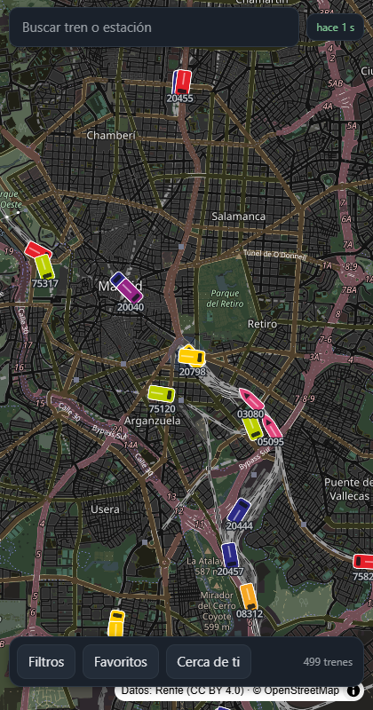

# TrainRadar24h

Mapa en tiempo real de los trenes de Renfe en España. Muestra dónde está cada tren, cuánto retraso lleva, su recorrido y las salidas y llegadas de cada estación. Es una aplicación web instalable (PWA) con un pequeño servidor en Python, y se despliega con Docker.

<p align="center">
  
</p>

> Proyecto independiente, sin relación con Renfe ni con Adif. Usa los datos abiertos que publica Renfe.

## Funciones

- **Mapa en vivo.** Todos los trenes de Renfe con posición publicada, actualizados cada 15 segundos y con movimiento suavizado entre lecturas. Cada tipo de tren tiene su silueta y su color:

  | Categoría | Servicios |
  |---|---|
  | Alta velocidad | AVE, AVLO, AVE INT, Euromed |
  | Larga distancia | Alvia, Intercity y otros de larga distancia |
  | Media distancia y regionales | MD, Regional, Regional Exprés, Avant, Proximidad |
  | Cercanías | Todas las líneas, con el color de cada línea |

- **Ficha del tren.** Retraso, próxima parada, andén, recorrido completo en el mapa y estado de cada parada. Se puede seguir el tren con la cámara y compartir su enlace (`/t/<id>`).
- **Búsqueda.** Por número de tren o por nombre de estación.
- **Panel de estación.** Salidas y llegadas de las próximas horas, con retraso y estado (`/s/<id>`).
- **Cerca de ti.** Con permiso de ubicación, muestra tu posición en el mapa y lista los trenes a menos de 25 km y las estaciones más próximas.
- **Filtros.** Por categoría y para ver solo los trenes con retraso.
- **Favoritos y avisos push.** Trenes y estaciones favoritos por dispositivo, sin cuentas. Avisos de retraso, cancelación, cambio de andén y salida inminente.
- **Tema claro y oscuro, y capa de vías** de OpenRailwayMap.
- **Funciona sin conexión.** Si se pierde la red, la app abre con los últimos datos y lo indica.

## Arquitectura

```
Renfe (GTFS estático + GTFS-RT) ──▶ api (FastAPI) ──▶ web (nginx + PWA React/MapLibre) ──▶ navegador
                                     │
                                     └─ SQLite en ./data
```

- **`api/`**: servidor en Python 3.12 con FastAPI.
  - Descarga cada madrugada los horarios estáticos de Renfe y los guarda en SQLite.
  - Cada 15 segundos lee los feeds en tiempo real y construye en memoria una «foto» con todos los trenes.
  - Sirve esa foto por REST con ETag, para que los clientes solo descarguen datos nuevos.
  - Guarda los favoritos y las suscripciones push y envía los avisos.
- **`web/`**: PWA en React 19, TypeScript y MapLibre GL, con mapa base de OpenStreetMap. En producción la sirve nginx, que también reenvía `/api` al servidor.

El servidor es necesario porque los feeds de Renfe no permiten peticiones directas desde el navegador (no tienen CORS) y porque hay que cruzar las posiciones con los horarios estáticos.

## Puesta en marcha

Requisitos: Docker con Docker Compose.

### Con las imágenes publicadas (recomendado)

Cada versión se publica en GitHub Container Registry para `linux/amd64` y `linux/arm64`:

- `ghcr.io/virapa/trainradar24h-api`
- `ghcr.io/virapa/trainradar24h-web`

No hace falta el código fuente, solo el fichero de Compose:

```bash
mkdir trainradar24h && cd trainradar24h
curl -fsSLO https://raw.githubusercontent.com/virapa/TrainRadar24h/main/deploy/docker-compose.yml
docker compose up -d
```

Para actualizar a la última versión:

```bash
docker compose pull && docker compose up -d
```

### Desde el código fuente

```bash
git clone https://github.com/virapa/TrainRadar24h.git
cd TrainRadar24h
cp .env.example .env
docker compose up -d --build
```

### Primer arranque

- App: <http://localhost:8091>
- API: <http://localhost:8090/api/health>, que también indica la versión en ejecución.

El primer arranque descarga los horarios de Renfe y prepara la base de datos, así que tarda uno o dos minutos en mostrar trenes. Los datos se guardan en `./data`.

### Versiones

Se sigue [versionado semántico](https://semver.org/lang/es/). Estas son las etiquetas de imagen disponibles:

| Etiqueta | Qué contiene | Cuándo se actualiza |
|---|---|---|
| `latest` | La última versión publicada | Con cada versión |
| `0.1.0` | Una versión concreta, que no cambia | Nunca |
| `0.1` | La última corrección de esa versión | Con cada corrección (`0.1.x`) |
| `edge` | Lo último de la rama `main`, sin publicar como versión | Con cada cambio en `main` |
| `sha-<commit>` | Un commit concreto de `main` | Nunca |

Para fijar una versión, define `TRAINRADAR_VERSION`, por ejemplo `TRAINRADAR_VERSION=0.1.0 docker compose up -d`. Mientras el proyecto esté en `0.x`, no se publica la etiqueta de versión mayor (`0`).

Para publicar una versión nueva:
1. Actualiza `version` en `api/pyproject.toml` y en `web/package.json`.
2. Crea una etiqueta y súbela; GitHub Actions pasa las pruebas, construye las imágenes y las publica:

   ```bash
   git tag v0.2.0
   git push origin v0.2.0
   ```

### Configuración

Todo es opcional salvo para los avisos push.

| Variable | Dónde | Para qué | Por defecto |
|---|---|---|---|
| `WEB_PORT` | entorno de `docker compose` | Puerto de la app en el equipo | `8091` |
| `API_PORT` | entorno de `docker compose` | Puerto de la API en el equipo | `8090` |
| `TRAINRADAR_VERSION` | entorno o `.env` (solo con imágenes publicadas) | Versión de las imágenes | `latest` |
| `VAPID_PUBLIC_KEY` | `.env` | Clave pública de los avisos push | vacía (avisos desactivados) |
| `VAPID_SUBJECT` | `.env` | Contacto que exige Web Push, con formato `mailto:...` | vacía (avisos desactivados) |

### Avisos push

1. Genera las claves una sola vez. La privada se guarda en `data/vapid_private.pem` y la pública se imprime en pantalla:

   ```bash
   docker compose run --rm api python scripts/gen_vapid.py /data
   ```

   En Git Bash para Windows, antepón `MSYS_NO_PATHCONV=1` al comando; si no, Git Bash cambia la ruta `/data` y la clave no se guarda.

2. Pon la clave pública en `VAPID_PUBLIC_KEY` y tu contacto en `VAPID_SUBJECT`, dentro de `.env`.
3. Reinicia con `docker compose up -d`.
4. En la app, abre Favoritos, pulsa «Activar» y marca un tren como favorito.

No subas nunca `data/` ni `.env` al repositorio; ya están en `.gitignore`.

### HTTPS y uso desde el móvil

Los navegadores solo permiten los avisos push, la ubicación y la instalación como app en páginas HTTPS o en `localhost`. Desde otro dispositivo de la red local, `http://<IP-del-equipo>:8091` funciona, pero sin esas tres funciones.

Para tenerlas, publica el puerto de la app detrás de HTTPS. Por ejemplo, con un proxy inverso con certificado (Caddy, Traefik) o con un túnel (Cloudflare Tunnel, Tailscale Funnel).

## Desarrollo

**API** (Python ≥ 3.12):

```bash
cd api
python -m venv .venv
.venv/bin/pip install -e ".[dev]"   # en Windows: .venv\Scripts\pip
.venv/bin/python -m pytest -q
```

**Web** (Node ≥ 22):

```bash
cd web
npm install
npm test
npm run dev
```

`npm run dev` sirve la app en <http://localhost:5180> y reenvía `/api` a la API del puerto 8090. Para usar otra dirección, define la variable `API_URL`.

### API REST

| Método y ruta | Descripción |
|---|---|
| `GET /api/health` | Estado del servidor y antigüedad de cada feed |
| `GET /api/trains` | Todos los trenes en circulación (admite `If-None-Match`) |
| `GET /api/trains/{id}` | Detalle de un tren: paradas, retrasos y trazado |
| `GET /api/search?q=` | Búsqueda de trenes y estaciones |
| `GET /api/stations/near?lat=&lon=` | Estaciones más cercanas a un punto |
| `GET /api/stations/{id}/board?tipo=salidas\|llegadas` | Panel de salidas o llegadas |
| `GET/PUT/DELETE /api/favorites` | Favoritos del dispositivo (cabecera `X-Device-Id`) |
| `GET /api/push/vapid-public-key` | Clave pública para suscribirse a los avisos |
| `POST/DELETE /api/push/subscription` | Alta y baja de la suscripción push |

### Estructura

```
api/            servidor FastAPI
  app/gtfs_static/  descarga y consulta de horarios (SQLite)
  app/realtime/     lectura de feeds GTFS-RT y «foto» de trenes
  app/alerts/       detección de cambios y envío de avisos push
  app/api/          rutas REST
  tests/            pruebas con feeds reales capturados
web/            PWA
  src/components/   mapa, ficha del tren, paneles
  src/hooks/        datos, ubicación, favoritos
  src/lib/          lógica pura con pruebas
  public/sw.js      service worker
docs/           diseño y planes de implementación
```

## Limitaciones conocidas

- **Solo trenes de Renfe y solo de viajeros.** Otros operadores (Iryo, Ouigo) y los trenes de mercancías no publican posiciones abiertas.
- **Los datos de Renfe tienen peculiaridades:**
  - El mismo tren aparece una vez por cada variante de recorrido.
  - Algunos trenes en marcha vienen con todas las paradas marcadas como suprimidas. En ese caso la app ignora la supresión.
  - Puede haber diferencias puntuales con la información oficial de Renfe.
- **Los trayectos de larga distancia se dibujan como líneas rectas entre paradas**, porque Renfe no publica su trazado.
- **El tema oscuro es el mapa de OpenStreetMap con los colores invertidos.**

## Datos y atribución

- **Horarios y tiempo real:** [Renfe Data](https://data.renfe.com/), licencia [CC BY 4.0](https://creativecommons.org/licenses/by/4.0/).
- **Mapa base:** © colaboradores de [OpenStreetMap](https://www.openstreetmap.org/copyright). Usa los servidores de teselas públicos de OSM, pensados para un uso ligero. Para un despliegue con muchos usuarios, cambia a un proveedor propio o de pago, según su [política de uso](https://operations.osmfoundation.org/policies/tiles/).
- **Capa de vías:** © [OpenRailwayMap](https://www.openrailwaymap.org/), CC BY-SA.
- **Tipografías de las etiquetas:** servidor de demostración de MapLibre.

## Licencia

El código se publica con licencia [MIT](LICENSE). Los datos y los mapas que usa la app tienen sus propias licencias, indicadas en el apartado anterior.
